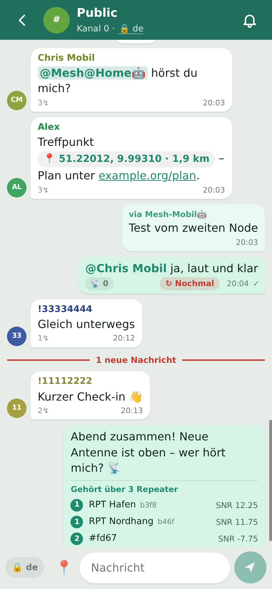
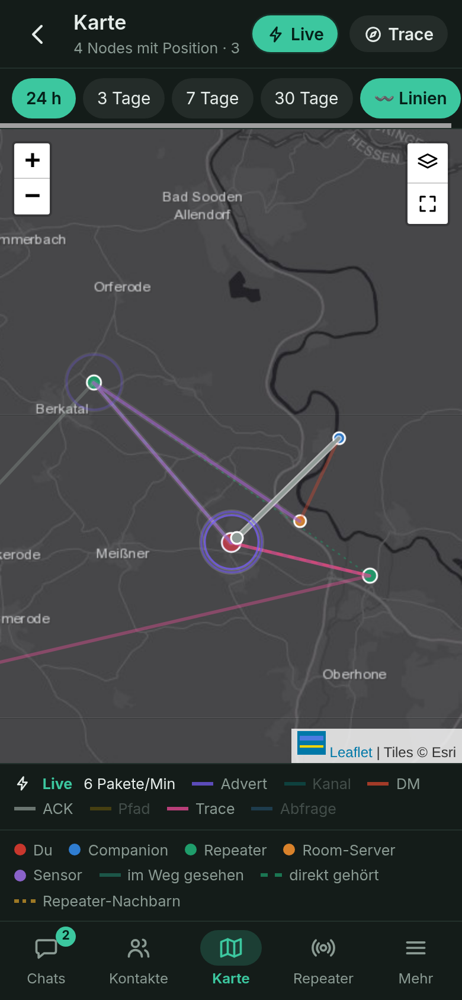
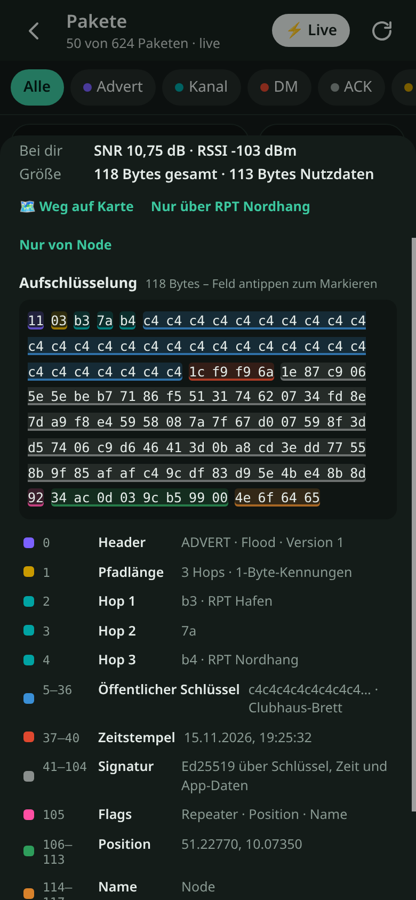
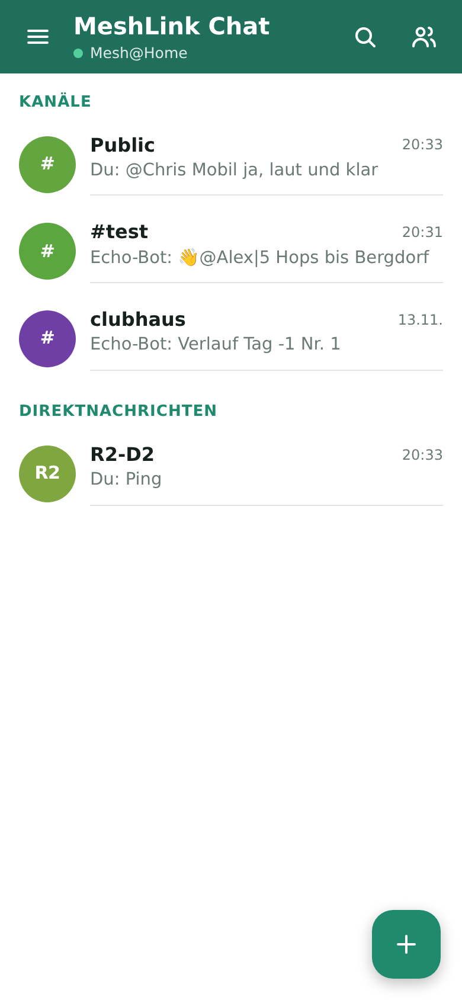
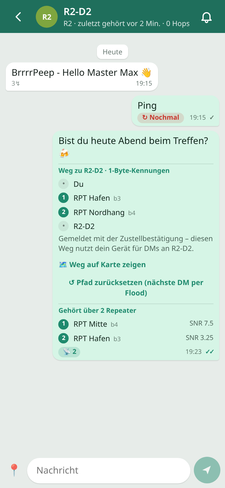
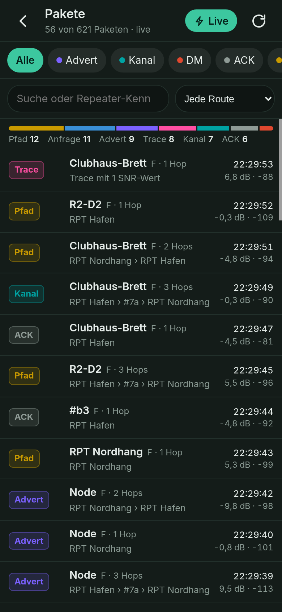
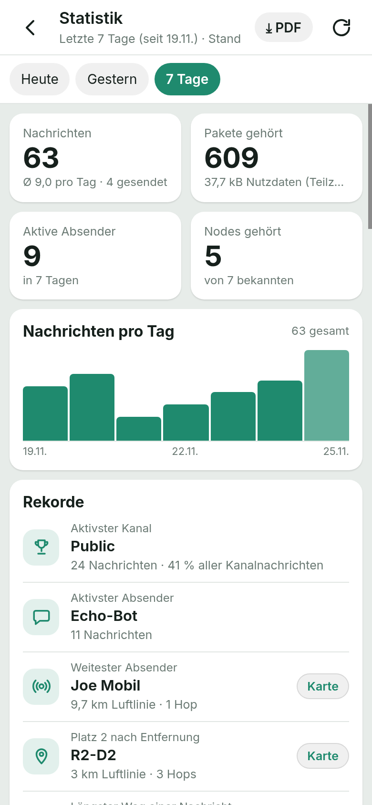
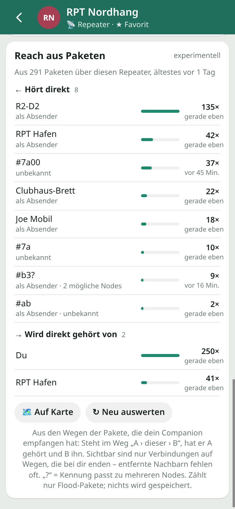
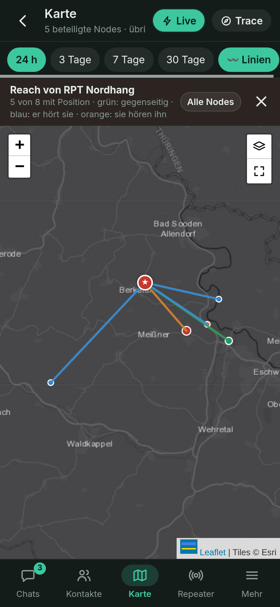
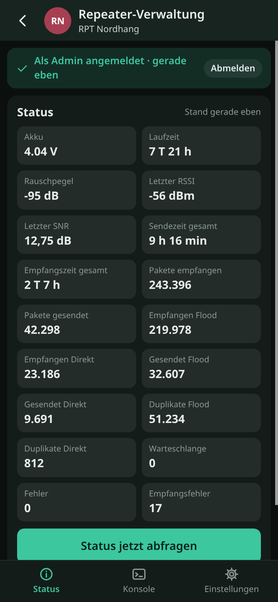

<div align="center">

**Deutsch** · [English](README.md)

# 📡 MeshLink Chat

**Der Messenger für dein MeshCore-Netz – als Web-App für MeshMonitor.**
<br><sub>Im Browser, auf dem Handy, ohne App-Store.</sub>

MeshLink Chat setzt sich auf deinen [MeshMonitor](https://github.com/Yeraze/meshmonitor) und macht daraus eine
Chat-App mit Karte, Live-Paketen, Paket-Analyzer und Push-Benachrichtigungen.
Gebaut für **MeshCore**. Meshtastic-Quellen bekommen den Grundumfang (Chat, Kontakte, Karte).

`v1.8.0` · Deutsch & English · keine npm-Abhängigkeiten · kein Build-Schritt · MIT-Lizenz

</div>

> [!NOTE]
> **Hobby-Projekt ohne Support.** Issues und Discussions sind bewusst ausgeschaltet. Nutzen, anpassen und forken ist
> ausdrücklich erwünscht (MIT).

<p align="center">
  
  
  
</p>

---

## Was kann MeshLink Chat?

💬 **Chatten wie gewohnt.** Kanäle und Direktnachrichten, Antworten, Reaktionen, Erwähnungen mit `@`, Zustellhaken,
ungelesen-Markierung, Suche. Läuft als installierbare PWA auf iPhone, Android und am PC, dort mit Chatliste und
Chat nebeneinander.

📡 **Sehen, wer dich gehört hat.** Unter jeder eigenen Nachricht steht, welche Repeater sie weitergesendet haben,
mit Hop-Position und SNR. Bei DMs zeigt MeshLink Chat nach der Zustellung den **tatsächlichen Weg zum Empfänger**. Bei
empfangenen Nachrichten siehst du den Weg zu dir, auf Wunsch auf der Karte mit Kilometern je Teilstück.

🗺️ **Eine Karte, die mitdenkt.** Alle Nodes mit Position, Verbindungslinien aus echten Nachrichtenwegen, acht
Kartenstile und Vollbild. Mit **⚡ Live** fliegt jedes Paket als farbiger Punkt über die Repeater zu dir, an jedem
Repeater läuft eine kleine Welle aus. Die Spur bleibt kurz stehen; tippst du sie an, siehst du Typ, Weg, Strecke und SNR.

🔬 **Paket-Analyzer.** MeshMonitors Paket-Log als filterbare Liste: nach Typ, Route, Repeater oder Absender.
Ein Tipp zerlegt das Paket **Byte für Byte** in farbige Felder: Header, Pfad, Schlüssel, Signatur, Position, MAC …

🛰️ **Reach (experimentell).** Wen hört ein Repeater direkt, und wer hört ihn? MeshLink Chat wertet dafür die Wege der
Pakete aus, die dein Companion empfangen hat. Es braucht keine zusätzlichen Nodes.

🧭 **Werkzeuge für Bastler.** Eigene Traceroute über selbst gewählte Repeater mit SNR hin und zurück, Repeater-Status,
Verläufe und Paketverkehr pro Stunde und Tag, Nachbarlisten, Direkt-Ping, Pfad zurücksetzen und eine DM per Flood neu senden, Advert senden.

📊 **Statistik.** Heute, gestern oder 7 Tage: Nachrichten und Pakete je Stunde, Rekorde (weitester Absender,
längster Weg …), Pakettypen, SNR/RSSI. Lässt sich als **PDF** speichern.

🔔 **Push.** Bei DMs, Erwähnungen und Reaktionen auf deine Nachrichten; pro Chat einstellbar. Dazu gibt es einen
**Repeater-Wächter**, der meldet, wenn ein Favoriten-Repeater verstummt oder sein Akku schwächelt.

🌍 **Deutsch und Englisch.** Die App folgt der Sprache des Browsers und lässt sich pro Gerät umstellen
(☰ → Einstellungen → Sprache). Push-Nachrichten kommen in der Sprache des jeweiligen Geräts. Weitere Sprachen
sind eine einzelne Datei, siehe [Weitere Sprache hinzufügen](#weitere-sprache-hinzufügen).

🌗 **Hell, dunkel oder wie das System.** Ein helles, ruhiges Design mit eigenen Linien-Symbolen und der
mitgelieferten Schrift Inter. Das Farbschema stellst du pro Gerät direkt im ☰-Menü um.

<p align="center">
  
  
  
  
</p>
<p align="center">
  
  
  
</p>

<sub>Alle Screenshots zeigen erfundene Testdaten.</sub>

## So funktioniert es

```
Handy / PC (PWA) ──HTTPS── Reverse-Proxy / Tunnel ── MeshLink Chat :8090 ──REST-API── MeshMonitor ── Companion-Node
```

Drei Grundsätze ziehen sich durch alles:

- **Nur die MeshMonitor-API.** MeshLink Chat spricht nie selbst mit dem Funkgerät. Der API-Token bleibt auf dem Server
  und erreicht nie den Browser.
- **Kein Datenhaufen.** Nachrichten, Nodes und Verläufe kommen frisch aus MeshMonitor und liegen nur im
  Arbeitsspeicher. Jeder Zwischenspeicher hat eine feste Obergrenze. Einzige Datei auf der Platte ist `push.json`
  mit höchstens 10 Push-Abos.
- **Restlos entfernbar.** Keine Pakete, keine Benutzer, keine Cronjobs. `uninstall.sh` räumt alles ab und prüft danach nach.

## Voraussetzungen

- Ein Linux-Host oder LXC mit **systemd** und **Node.js ≥ 18**, am besten derselbe, auf dem MeshMonitor läuft.
  Der Dienst läuft als `DynamicUser` in einer Sandbox, mit höchstens 192 MB RAM.
- **MeshMonitor ab 4.14** mit einem **API-Token** (Benutzermenü → *API Token*). Empfohlen ist 4.17.3 oder neuer,
  dann gelten die genauen Nachrichtenlängen der Firmware und DMs zeigen ihre Repeater-Echos.
- **HTTPS** für die volle PWA (installieren, Push, Standort), z. B. per Cloudflare-Tunnel, Caddy/Nginx mit
  Let's Encrypt oder Tailscale. Im LAN über `http://` läuft die App auch, nur ohne diese drei Funktionen.

<details>
<summary><b>Welche Rechte braucht der Token?</b></summary>

Der Token hat die Rechte des Benutzers, der ihn erstellt hat. Vergib die Rechte also am Benutzer, ein neuer Token
ist dafür nicht nötig. Fehlt ein Recht, sagt die App das an der jeweiligen Stelle; alles andere funktioniert weiter.

| Funktion | Recht in MeshMonitor |
|---|---|
| Nachrichten lesen / senden, Resend, Reaktionen, Room-Server, Repeater-Status | `messages` lesen / schreiben |
| Kontakte, Karte, Telemetrie-Verlauf | `nodes` lesen |
| Favoriten, Direkt-Ping, Pfad zurücksetzen / suchen | `nodes` schreiben |
| Advert senden | `connection` schreiben |
| Traceroute | `traceroute` lesen + schreiben |
| Scope-Liste und Standard-Scope | `configuration` lesen |
| Live-Karte, Paket-Analyzer, Reach | `packetmonitor` lesen |
| Repeater-Verwaltung (nur mit `REMOTE_ADMIN=1`) | `remote_admin` lesen + schreiben |

</details>

## Installation

Auf dem Server bzw. LXC, auf dem MeshMonitor läuft, als root:

```bash
apt install -y git nodejs        # falls noch nicht vorhanden (Node.js ≥ 18)
git clone https://github.com/Felliglanz/Meshlink-Chat.git /root/meshlink-chat
cd /root/meshlink-chat && ./install.sh
```

`install.sh` fragt nach der MeshMonitor-URL (meist wird sie erkannt), dem API-Token, einem App-Passwort, der
Bind-Adresse und dem Port. Es spricht Deutsch, wenn das System auf Deutsch steht, sonst Englisch
(fest wählen: `MESHLINK_LANG=de ./install.sh`). Dann kopiert es das Programm nach `/opt/meshlink-chat`, richtet den Dienst
`meshlink-chat` ein und testet die Verbindung. Der Clone-Ordner ist nur die Quelle, laufen tut alles aus `/opt`.

### Danach

1. **HTTPS davorschalten**: Tunnel oder Reverse-Proxy auf `http://<server>:8090`. Wenn er auf demselben Host läuft,
   kannst du bei der Installation `127.0.0.1` als Bind-Adresse wählen. Ein Zugangsschutz davor, z. B. Cloudflare
   Access, schadet nie.
2. **Auf dem Handy öffnen**, anmelden, *Zum Home-Bildschirm hinzufügen*.
3. **Push einschalten**: ☰ → Einstellungen → Push-Benachrichtigungen.

### Umstieg vom alten Namen „MeshChat“

Läuft noch eine ältere Version unter `/opt/meshchat`, erkennt `install.sh` das. Es bietet an, die Konfiguration
(Token, Passwort, Port) zu übernehmen und die alte Installation zu entfernen. Danach musst du Push auf den Geräten
einmal neu einschalten und die App auf dem Home-Bildschirm neu anlegen, weil sich der Name geändert hat.

## Update, Wartung, Entfernen

```bash
cd /root/meshlink-chat && git pull && ./install.sh --update   # Update (.env bleibt)
/opt/meshlink-chat/uninstall.sh                               # alles restlos entfernen (fragt vorher)
systemctl status meshlink-chat                                # läuft der Dienst?
journalctl -u meshlink-chat -f                                # Log live ansehen
/opt/meshlink-chat/install.sh --check                         # Verbindungstest: Quelle, MeshMonitor-Version, Längen
```

Offene Apps laden sich nach einem Update von selbst neu. Wenn du nur die Konfiguration ändern willst:
`nano /opt/meshlink-chat/.env` und danach `/opt/meshlink-chat/install.sh --update`. Zurück zu einer älteren Version:
`git checkout <tag oder commit>` und dann `./install.sh --update`.

<details>
<summary><b>Alle Einstellungen in der <code>.env</code></b></summary>

| Einstellung | Standard | Bedeutung |
|---|---|---|
| `MM_URL`, `MM_TOKEN` | – | Adresse von MeshMonitor und API-Token |
| `APP_PASSWORD` | – | Login-Passwort der App (mind. 8 Zeichen) |
| `SESSION_SECRET` | zufällig | Schlüssel für Sitzungen und Push; ändern = alle Geräte abgemeldet |
| `SESSION_DAYS` | `30` | so lange bleibt ein Gerät angemeldet |
| `BIND_ADDR`, `HOST_PORT` | `0.0.0.0`, `8090` | Adresse und Port, auf denen MeshLink Chat lauscht |
| `MM_SOURCE` | primäre Quelle | feste Quelle (sourceId) in MeshMonitor |
| `MY_NODE_ID` | automatisch | eigene Node-ID, falls die Erkennung nicht klappt (`!a1b2c3d4` oder `mc:<pubkey>`) |
| `MY_NAME` | automatisch | eigener Absendername in Kanälen, falls er (noch) nicht aus gesendeten Nachrichten gelernt ist |
| `REMOTE_ADMIN` | `0` | `1` = Repeater-Verwaltung an (siehe unten) |
| `POLL_MS`, `IDLE_POLL_MS` | `3000`, `15000` | Abfrage-Intervall in ms (App offen / keine App offen) |
| `HISTORY_LIMIT` | `500` | so viele Nachrichten holt der Server je vollständigem Abruf (im Speicher höchstens das Dreifache) |
| `PUSH_CONTACT` | Platzhalter | Kontakt für Push-Dienste (`mailto:…` oder `https://…`), nur nötig, wenn ein Dienst ihn verlangt |

Nach jeder Änderung: `/opt/meshlink-chat/install.sh --update`.

</details>

`uninstall.sh` entfernt den Dienst, `/opt/meshlink-chat` und die Push-Abos und prüft am Ende, dass nichts übrig ist.
Den Clone-Ordner und außerhalb räumst du selbst auf: den HTTPS-Eintrag, den API-Token in MeshMonitor und das App-Symbol
auf dem Handy.

<details>
<summary><b>Alternative: vom PC aus mit <code>scripts/deploy.sh</code></b></summary>

Für Entwicklung oder wenn auf dem Server kein git sein soll: Lege im Projektordner eine `.deploy.env` an
(wird nie eingecheckt):

```bash
MESHLINK_HOST=root@192.168.1.50      # dein Server/LXC
MESHLINK_KEY=~/.ssh/id_ed25519       # optional: SSH-Schlüssel
```

```bash
scripts/deploy.sh install    # erstmals: überträgt den Code und startet install.sh (fragt alles ab)
scripts/deploy.sh            # Update (.env bleibt)
scripts/deploy.sh check      # Verbindungstest: Quelle, MeshMonitor-Version, Nachrichtenlängen
scripts/deploy.sh status     # Dienststatus
scripts/deploy.sh logs       # letzte Log-Zeilen
scripts/deploy.sh uninstall  # restlos entfernen
```

Vor jeder Übertragung prüft das Skript die Syntax aller Dateien. Dabei geht nichts auf den Server, wenn etwas kaputt ist.

</details>

## Bedienung im Detail

<details>
<summary><b>💬 Chats</b></summary>

- **Leiste unten:** Chats · Kontakte · Karte · Repeater (nur MeshCore) · Mehr (= das ☰-Menü). Die Zahl an „Chats“
  zählt die Chats mit ungelesenen Nachrichten. Im geöffneten Chat ist die Leiste ausgeblendet, am PC sitzt sie unter der
  Chatliste. Das ☰-Menü zeigt nur, was die Leiste nicht hat, dazu den Schalter **System · Hell · Dunkel** (pro Gerät).
- **Suchen und filtern:** Die Suchzeile über der Liste sucht im Namen der Chats (Nachrichtentext: ☰ → Nachrichten
  suchen). Darunter die Filter **Alles · Ungelesen · ★ · DMs · Kanäle**; ★ zeigt DMs mit Favoriten-Kontakten. Den Filter
  merkt sich jedes Gerät.
- **Chatliste:** Der Knopf ⇅ über den Kanälen sortiert sie wie im Gerät, nach neuester Nachricht, nach den meisten
  Nachrichten (im geladenen Verlauf) oder alphabetisch. Die Wahl merkt sich jedes Gerät selbst.
- **Kanal-Symbol (MeshCore):** **#** = Hashtag-Kanal (Schlüssel aus dem Namen, jeder mit dem Namen kann mitlesen),
  **Schloss** = privater Kanal (eigener Schlüssel), **Globus** = Public. Der Server erkennt die Art am Schlüssel aus
  MeshMonitor. Der Schlüssel selbst geht nie an die App.
- **Nachricht nach rechts wischen**: antworten (Android vibriert kurz, sobald Loslassen antwortet).
- **Lange drücken** (am PC: Rechtsklick) auf eine Nachricht: Reaktion, Antworten, Kopieren, DM, Details.
  **Doppeltippen**: ❤️. **Auf eine Reaktion tippen**: dieselbe Reaktion senden. Reaktionen gehen ins Mesh und lassen
  sich nicht zurücknehmen (bei MeshCore muss „Reaktionen senden“ in MeshMonitor für die Quelle erlaubt sein).
- **Das Antennen-Symbol mit Zahl** unter eigenen Kanalnachrichten zeigt, wie viele Repeater sie hörbar weitergesendet haben. Antippen zeigt sie
  mit Position im Weg und SNR. Einen SNR-Wert gibt es nur für die Station, die dein Gerät direkt gehört hat. Die übrigen
  stehen nur im Weg. Zugeordnet wird über die verschlüsselten Bytes des Pakets, die bei jeder Kopie gleich sind. So zählen
  auch Echos nach einem Resend, und jemand, der zur selben Zeit denselben Text schreibt, wird nicht mitgezählt.
- **Eigene DM:** Das Antennen-Symbol erscheint, sobald MeshMonitor Repeater-Echos gehört hat. Nach der Zustellung (✓✓) steht in den
  Details der **Weg zum Empfänger**, den der Empfänger mit der Bestätigung zurückmeldet. Eine eigene DM lange
  drücken bietet **Pfad zurücksetzen** und, solange sie nicht zugestellt ist, **per Flood neu senden**.
- **Empfangen:** `↳ 2 Hops · 1B` zeigt den Weg zu dir und die Hash-Größe (1/2/3 Byte je Repeater-Kennung).
  „Weg auf Karte zeigen“ zeigt die Strecke mit Luftlinie je Teilstück.
- **↻ Nochmal** (wenn noch kein Repeater sie gehört hat bzw. eine DM unbestätigt ist; ab 30 s, max. 3×, bis 1 Std.):
  ein echtes Resend über MeshMonitor, also gleiche Nachricht, gleicher Zeitstempel und keine Dopplung beim Empfänger.
- **Scope je Kanal:** steht im Chatkopf und neben dem Eingabefeld, antippen zum Wechseln. Die Wahl gilt nur für
  diese App auf diesem Gerät.
- **Länge:** Der Zähler zählt Bytes. MeshCore ab MeshMonitor 4.17.3: DM 160, Kanal 160 minus Länge deines
  Node-Namens minus 2 (ältere Versionen: DM 150, Kanal 130 bzw. 120 mit Scope). Meshtastic: 200. Lange Texte werden
  **nicht** geteilt.
- **🔔 im Chatkopf:** pro Chat *Standard*, *Alle Nachrichten* oder *Stumm*.
- **Links und Koordinaten** sind antippbar; Koordinaten öffnen die Karte mit Entfernung zu dir. **📍** fügt deinen
  Standort ein (braucht HTTPS).
- Der **Gelesen-Stand** gleicht sich zwischen Handy und PC ab.

</details>

<details>
<summary><b>🗺️ Karte</b></summary>

- Nodes mit Position aus den letzten 24 h / 3 / 7 / 30 Tagen; jedes Popup zeigt Entfernung und Richtung von dir.
- **〰 Linien:** im Weg empfangener Nachrichten gesehen (durchgezogen), direkt gehört (gestrichelt),
  Repeater-Nachbarn (gepunktet).
- **Kartenstil** (oben rechts): Automatisch, OpenStreetMap, Dunkel, Dunkelgrau, Hellgrau, Humanitarian, Satellit,
  Topografisch. Es sind nur Dienste ohne API-Schlüssel dabei; die Kacheln lädt dein Gerät direkt vom Anbieter.
- **Vollbild** (darunter): zurück per Knopf, Zurück-Geste oder Esc.
- **⚡ Live:** Der Server fragt das Paket-Log alle 3 s ab, aber nur, solange eine Karte mit Live offen ist. Das ist ein
  Abruf für alle Geräte. Farben: Advert, Kanal, DM, ACK, Pfad, Trace, Abfrage. Die Spur bleibt ~12 s antippbar.
- **Fokus:** Zeigt die Karte einen Weg, eine Traceroute, Nachbarn oder Reach, siehst du nur die beteiligten Nodes,
  und Live pausiert. „Alle Nodes“ blendet den Rest wieder ein, ✕ beendet den Fokus.
- **🧭 Trace:** Repeater der Reihe nach antippen (der letzte ist das Ziel), dann „Senden“. Die Trace läuft hin und
  zurück, mit SNR je Strecke. Dafür setzt MeshLink Chat kurz den gespeicherten Pfad des Ziels und stellt ihn danach sofort
  wieder her. Das Ziel muss ein Kontakt deines Companions sein.

</details>

<details>
<summary><b>🔬 Paket-Analyzer und Reach</b></summary>

- **Paket-Analyzer** (☰ → Werkzeuge): Filter nach Typ und Route; die Suche nimmt Text, Namen oder eine
  Repeater-Kennung (`b3f8` = „über diesen Repeater“). ⚡ Live holt alle 4 s Neues dazu. `×3` heißt: derselbe Inhalt
  kam über drei Wege an. Das Detail zerlegt das Paket Byte für Byte; ein Feld antippen markiert es im Hex-Block.
  Verschlüsselte Inhalte bleiben verschlüsselt, Kanaltext erscheint, wenn MeshMonitor den Kanal kennt. Gefiltert wird
  bei MeshMonitor: höchstens 100 Pakete je Abruf, 500 in der App, beim Verlassen ist alles weg.
- **Reach** (Node-Seite eines Repeaters): Steht im Weg eines Pakets „A › X › B“, dann hat X A gehört und B hat X
  gehört. Steht X vorne, hörte er den Absender; steht er hinten, hörst du ihn. Gezählt werden nur Flood-Pakete
  (bei direkt gerouteten steht im Pfad die geplante Route). **Grenzen:** Sichtbar sind nur Wege, die bei dir enden;
  entfernte Nachbarn fehlen deshalb oft. `?` heißt, die Kennung passt zu mehreren Nodes; dafür wird keine Position
  geraten. Auf der Karte: grün gegenseitig, blau „er hört sie“, orange „sie hören ihn“. Eine Linie antippen zeigt beide
  Richtungen mit Häufigkeit.

</details>

<details>
<summary><b>📇 Kontakte, Repeater, Statistik und mehr</b></summary>

- **Kontakte** (👥): Favoriten / Alle / Repeater. Jede Zeile zeigt Art, gespeicherten Weg (direkt, Hops oder Flood) und
  den Anfang des Schlüssels; ★ am Bild = Favorit. Tippen öffnet den Chat (Repeater und Rooms: die Node-Seite), ⋮ das Menü
  mit Nachricht, Details, Favorit (in MeshMonitor und auf dem Companion), Karte und „Schlüssel kopieren“.
- **Chatliste:** Kanäle mit eigenem oder abweichendem Scope tragen ein kleines 🔒-Schild.
- **Node-Seite:** Status per Funk abfragen (max. 1×/Min.), Verläufe (Akku, Rauschen, Pakete), Traceroute,
  gespeicherter Pfad, Direkt-Ping, Pfad zurücksetzen/suchen, Nachbarn, Reach. Alles lässt sich auch auf der Karte zeigen.
- **Nachbarn abfragen:** Ein Repeater schickt je Anfrage höchstens 10 Nachbarn (Grenze der Firmware). „Weitere laden“
  holt die nächsten, „Auf Karte“ zeigt danach alle geladenen. Jede Seite ist eine eigene Anfrage per Funk.
- **Repeater-Übersicht:** alle Favoriten-Repeater mit Ampel, zuletzt gehört, Akku, Rauschen, SNR, Laufzeit und Paketen pro
  Stunde bzw. 24 h.
- **Paketverkehr** (Node-Seite eines Repeaters): empfangene und gesendete Pakete pro Stunde, in den letzten 24 h und
  je Tag der letzten 7 Tage. Die Zahlen kommen aus den eigenen Zählern des Repeaters (Differenz zweier Status-Werte),
  nichts wird geschätzt. Nach einem Neustart des Repeaters steht „≥“ (Mindestwert), fällt eine Tagesgrenze in eine
  Messlücke über 3 Std., bleibt der Tag leer. Voraussetzung: MeshMonitor fragt den Status des Repeaters regelmäßig ab.
- **Repeater-Wächter** (Einstellungen): Push, wenn ein Favorit 1–24 Std. still ist oder sein Akku unter 3,5/3,6/3,7 V
  fällt, und eine Entwarnung, wenn es wieder passt.
- **Statistik:** Heute, Gestern oder 7 Tage, bei jedem Öffnen frisch berechnet. Paketzahlen reichen nur so weit wie das
  Paket-Log von MeshMonitor (Standard 24 h / 1000 Pakete). **⤓ PDF** öffnet den Druckdialog mit A4-Layout.
- **Erwähnungen:** alle `@`-Erwähnungen der letzten 7 Tage über alle Kanäle.
- **Room-Server:** Beiträge lesen auch ohne Anmeldung, zum Schreiben anmelden. Unter dem Anmelden steht der Weg zum Room.
- **Meine weiteren Nodes:** eigene Zweitgeräte. Sie erscheinen als „via …“, ohne Zähler und ohne Push.
- **Quelle:** erscheint bei mehreren Quellen in MeshMonitor; dauerhaft per `MM_SOURCE` in der `.env`.
- **Sprache** (Einstellungen): *Automatisch* folgt dem Browser, sonst Deutsch oder Englisch fest. Gilt nur auf diesem
  Gerät; die Wahl liegt als Cookie im Browser, auf dem Server wird nichts gespeichert.
- **Am PC** (ab 1000 px Breite): Liste und Chat nebeneinander, 😊-Knopf, Enter sendet, Umschalt+Enter macht eine neue Zeile.
- **Neu laden:** ☰ → Neu laden. Die App selbst lässt sich nicht mehr mitziehen, das Herunterziehen zum Neuladen gibt es deshalb nicht.
- **Version** unten im ☰-Menü antippen öffnet die Projektseite auf GitHub (nur ein Link; die App selbst ruft GitHub nie ab).

</details>
<details>
<summary><b>🔧 Repeater-Verwaltung (Admin)</b></summary>

Ausgeschaltet, bis du in der `.env` **`REMOTE_ADMIN=1`** setzt und den Dienst neu startest
(`systemctl restart meshlink-chat`). Dann steht auf der Node-Seite eines Repeaters oder Room-Servers **Verwaltung** (Schraubenschlüssel).
Alles läuft über MeshMonitor; der Token braucht `remote_admin` lesen + schreiben, und der Repeater muss als Kontakt auf
deinem Gerät gespeichert sein.

- **Anmelden** mit dem Admin-Passwort des Repeaters. MeshLink Chat speichert es nicht. Auf Wunsch merkt es sich
  **MeshMonitor** verschlüsselt, dann reicht später „Mit gemerktem Passwort anmelden“. Die Anmeldung kann bis zu
  2 Minuten dauern. MeshMonitor merkt sich die Sitzung; „Abmelden“ vergisst sie, sendet aber nichts. Im Knopf steht der
  gespeicherte Weg zum Repeater (direkt, Hops oder Flood). Das Gastpasswort reicht für die Verwaltung nicht.
- **Status:** Akku, Laufzeit, Sende- und Empfangszeit, RSSI, SNR, Rauschpegel, Paketzähler (Flood/Direkt), Duplikate, Fehler.
- **Konsole:** beliebige Befehle der Repeater-Firmware (`ver`, `get …`, `set …`, `neighbors` …), eine Antwort je Befehl.
- **Einstellungen:** Name, Position, Advert-Intervalle lesen und speichern; Weiterleiten an/aus, Advert senden, Uhrzeit
  lesen und synchronisieren, Nachbarn (mit Karte), Funk-Einstellungen, Version, Gast-Passwort, Neustart.
- **Gefährliche Befehle** (`reboot`, `erase`, `factory` …) laufen erst, wenn du den Namen des Repeaters eintippst.
- **Jede Abfrage ist Funkverkehr**, deshalb gibt es nichts automatisch, nur auf Knopfdruck.

**Bedenke:** Wer die App öffnen kann, kann damit Repeater umstellen. Schalte es nur ein, wenn nur du (bzw. Leute, denen
du das zutraust) Zugang zur App haben.

</details>

## Wenn etwas hakt

| Symptom | Ursache / Abhilfe |
|---|---|
| „MeshMonitor nicht erreichbar“ | `MM_URL` falsch oder MeshMonitor aus → `/opt/meshlink-chat/install.sh --check` |
| „MeshMonitor lehnt den API-Token ab“ | Token widerrufen oder abgelaufen → neuen in die `.env` |
| „Keine Berechtigung …“ | dem Token-Benutzer das genannte Recht geben (Tabelle oben) |
| Kein Push | nur über HTTPS; im Menü aus- und wieder einschalten, „Test-Benachrichtigung“ nutzen |
| Jede DM kommt doppelt als Push | MeshMonitor meldet DMs selbst → dort bei der Quelle unter *Notifications* „Direct messages and room posts“ aus |
| Karte bleibt grau | das Gerät erreicht den Kachel-Anbieter nicht → anderen Kartenstil wählen |

Hat sich nach einem MeshMonitor-Update ein Datenformat geändert, zeigt `/api/debug` (angemeldet, im Browser) die rohen
Antworten von MeshMonitor.

## Sicherheit

- Login mit App-Passwort, Sitzungs-Cookie (HttpOnly, SameSite=Strict, 30 Tage). Nach 8 Fehlversuchen je Adresse
  (40 insgesamt) ist der Login 15 Minuten gesperrt.
- Der Dienst läuft ohne Rechte in einer systemd-Sandbox und darf nur in sein Zustandsverzeichnis schreiben.
- Content-Security-Policy erlaubt nur die eigenen Dateien und die Kachel-Anbieter. Live-Verbindungen sind auf 50 begrenzt.
- Repeater-Verwaltung ist ab Werk aus (`REMOTE_ADMIN`). Admin-Passwörter speichert MeshLink Chat nie.
- Eigene Nachrichten erkennt die App an MeshMonitors Kennung bzw. der eigenen Node-ID, nicht am Namen: Wer im Kanal unter
  deinem Namen schreibt, erscheint als fremde Nachricht. Ein eigenes zweites Gerät mit gleichem Namen trägst du unter
  „Meine weiteren Nodes“ ein.
- Bitte **nicht direkt ins Internet** stellen, sondern nur hinter HTTPS-Proxy oder Tunnel, am besten mit Zugangsschutz.

## Weitere Sprache hinzufügen

Alle Texte stehen in `public/i18n/`, eine Datei je Sprache (`de.json`, `en.json`). Für eine neue Sprache:

1. `public/i18n/en.json` kopieren, z. B. nach `public/i18n/fr.json` (Dateiname = Sprachcode).
2. Oben `_meta` anpassen: `"name": "Français"` (so erscheint sie in der Auswahl) und `"locale": "fr-FR"`
   (Zahlen- und Datumsformat).
3. Die Texte übersetzen. Platzhalter wie `{name}` oder `{n}` unverändert lassen. Einträge mit `"one"`/`"other"`
   sind Mehrzahlformen; Sprachen mit mehr Formen dürfen zusätzlich `"few"`, `"many"` usw. haben
   ([Intl.PluralRules](https://developer.mozilla.org/docs/Web/JavaScript/Reference/Global_Objects/Intl/PluralRules)).
   Einfaches HTML wie `<b>` oder `<br>` darf bleiben.
4. Prüfen: `node scripts/check-i18n.js`. Es meldet falsche Platzhalter und listet fehlende Texte.
5. Ausrollen wie ein Update (`./install.sh --update`). Die Sprache taucht dann von selbst in der Auswahl auf.

Fehlt in einer Sprache ein Text, zeigt die App an dieser Stelle den englischen. Man kann also auch mit einer
teilweisen Übersetzung anfangen.

## Entwickeln

```bash
MOCK_PROTO=meshcore MOCK_MEPOS=1 node scripts/mock-meshmonitor.js &
MM_URL=http://127.0.0.1:18080 MM_TOKEN=mm_v1_test APP_PASSWORD=testtest123 PORT=18090 node server/server.js
# → http://127.0.0.1:18090  (Passwort testtest123)
```

Der Mock ist ein Fake-MeshMonitor mit erfundenen Nodes, Nachrichten und Live-Paketen samt Rohdaten.
Weitere Schalter: `MOCK_NODES=300` (viele Nodes), `MOCK_LIVE=0` (ohne Live-Verkehr), `MOCK_MMVER=4.17.2`
(ältere MeshMonitor-Version).

Texte gehören nie fest in den Code: In der App `T('bereich.name', { … })`, im Server ebenso über `i18n.translator()`.
Neue Einträge in `de.json` und `en.json` ergänzen und mit `node scripts/check-i18n.js` prüfen
(`scripts/deploy.sh` macht das vor jeder Übertragung).

| Pfad | Inhalt |
|---|---|
| `server/server.js` | Node-Server: Login, Polling, Live-Stream (SSE), alle `/api/…`-Endpunkte. `normNode()`/`normMsg()` kennen das Datenformat von MeshMonitor. |
| `server/push.js` | Web Push ohne Bibliothek (VAPID aus `SESSION_SECRET` abgeleitet) |
| `server/i18n.js` | lädt die Sprachdateien, wählt die Sprache je Gerät (Cookie `ml_lang`, sonst Browser-Sprache) |
| `public/` | die PWA: `index.html`, `style.css`, `sw.js`, Manifest, Icons, Leaflet |
| `public/fonts/` | Schrift Inter (SIL Open Font License, `OFL.txt`) |
| `public/js/` | die App als ES-Module ohne Build-Schritt: Einstieg `main.js`, Grundlagen in `core/` (Sprache, Zustand, API, Helfer), Ansichten in `views/`, Chat in `chat/`, Karte und Paket-Analyzer in `map/` |
| `public/i18n/` | Sprachdateien, eine je Sprache |
| `install.sh` / `uninstall.sh` | Einrichten, Aktualisieren, Entfernen auf dem Server |
| `scripts/deploy.sh` | vom PC aus installieren, aktualisieren, prüfen |
| `scripts/mock-meshmonitor.js` | Fake-MeshMonitor für die Entwicklung |
| `scripts/check-i18n.js` | prüft die Sprachdateien gegen den Code |
| `scripts/make-icons.py` | erzeugt die PNG-Icons |

## Lizenz

MIT, siehe [LICENSE](LICENSE). Enthält [Leaflet](https://leafletjs.com) (BSD-2-Clause, `public/vendor/leaflet/LICENSE`)
und die Schrift [Inter](https://rsms.me/inter/) (SIL Open Font License 1.1, `public/fonts/OFL.txt`).
MeshLink Chat ist ein eigenständiges Projekt und gehört weder zu MeshMonitor noch zu MeshCore oder Meshtastic.
