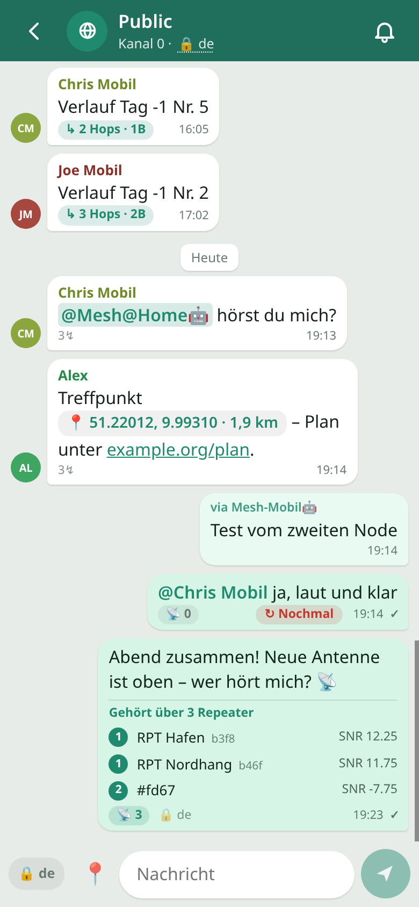
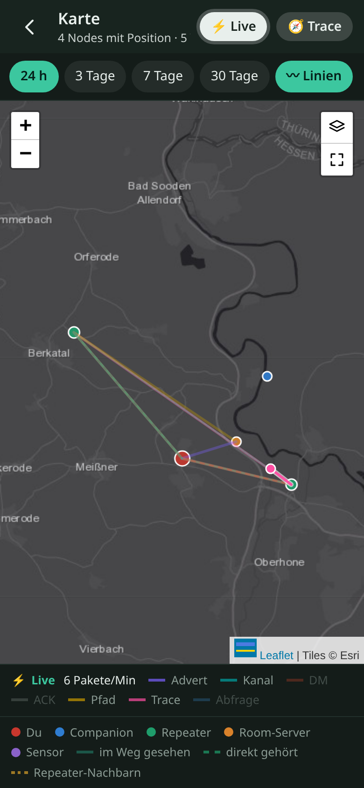
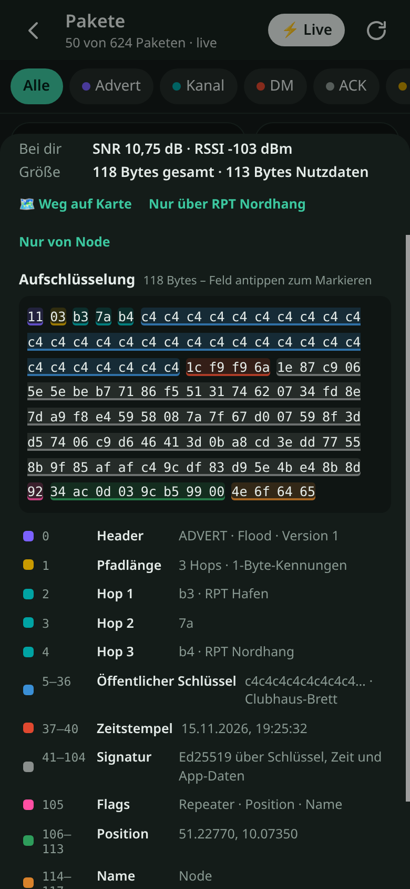
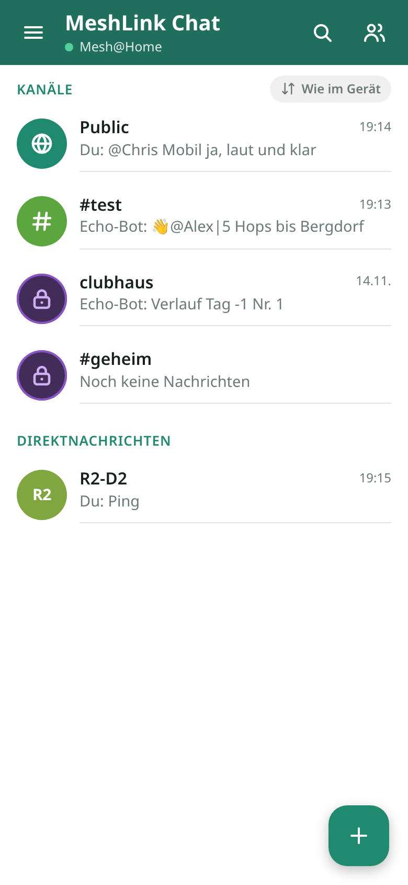
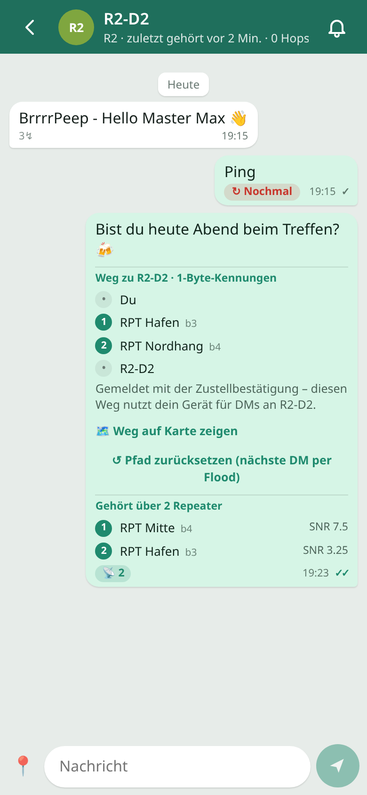
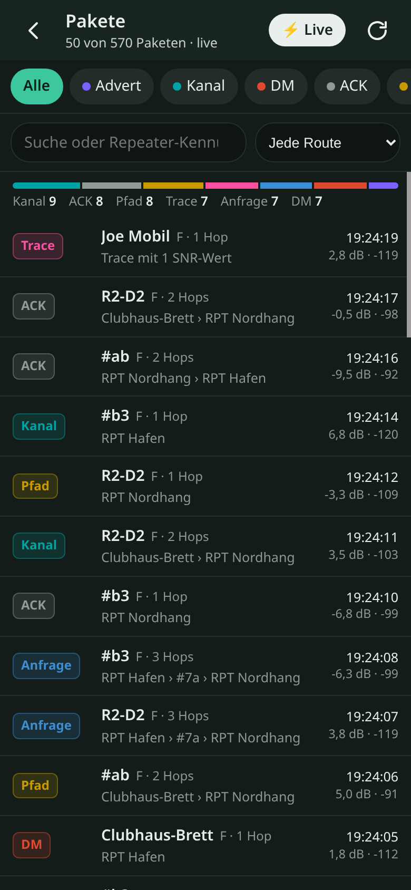
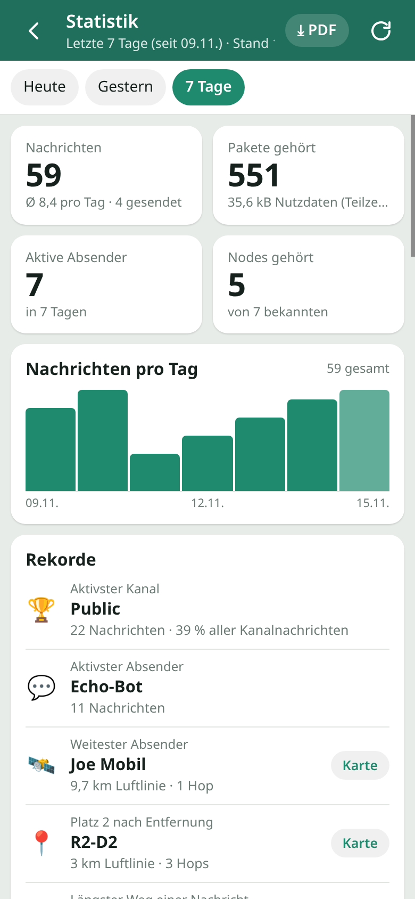
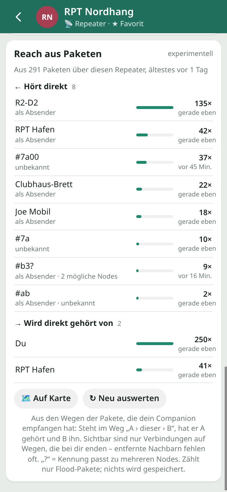
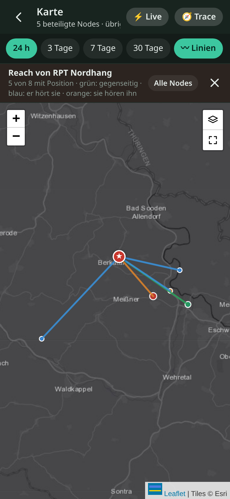
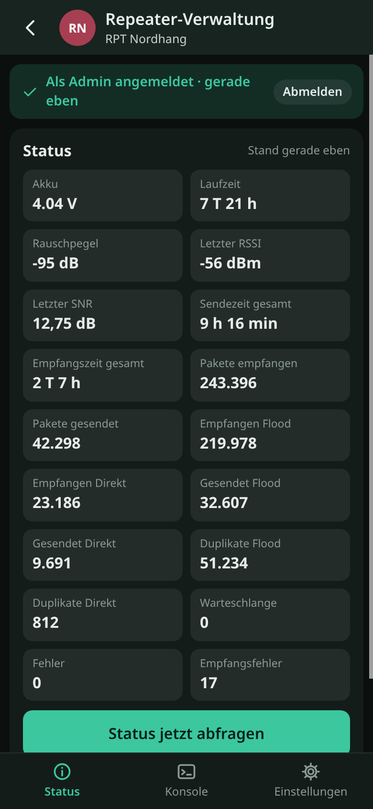

<div align="center">

[Deutsch](README.de.md) · **English**

# 📡 MeshLink Chat

**The messenger for your MeshCore network – as a web app for MeshMonitor.**
<br><sub>In the browser, on your phone, no app store.</sub>

MeshLink Chat sits on top of your [MeshMonitor](https://github.com/Yeraze/meshmonitor) and turns it into a
chat app with a map, live packets, a packet analyzer and push notifications.
Built for **MeshCore**. Meshtastic sources get the basics (chat, contacts, map).

`v1.4.1` · English & Deutsch · no npm dependencies · no build step · MIT license

</div>

> [!NOTE]
> **Hobby project without support.** Issues and Discussions are turned off on purpose. Using, adapting and forking
> is explicitly welcome (MIT).

<p align="center">
  
  
  
</p>

---

## What can MeshLink Chat do?

💬 **Chat as usual.** Channels and direct messages, replies, reactions, mentions with `@`, delivery ticks,
unread markers, search. Runs as an installable PWA on iPhone, Android and desktop, where the chat list and the
chat sit side by side.

📡 **See who heard you.** Under each of your messages you see which repeaters forwarded it, with hop position and
SNR. For DMs, MeshLink Chat shows the **actual path to the recipient** once delivered. For received messages you
see the path to you, optionally on the map with the distance of each leg.

🗺️ **A map that thinks along.** All nodes with a position, links from real message paths, eight map styles and
full screen. With **⚡ Live**, every packet flies as a coloured dot via the repeaters to you, with a small ripple
at each repeater. The trail stays for a moment; tap it to see type, path, distance and SNR.

🔬 **Packet analyzer.** MeshMonitor's packet log as a filterable list: by type, route, repeater or sender.
One tap breaks the packet down **byte by byte** into coloured fields: header, path, key, signature, position, MAC …

🛰️ **Reach (experimental).** Whom does a repeater hear directly, and who hears it? MeshLink Chat works this out
from the paths of the packets your companion received. No extra nodes needed.

🧭 **Tools for tinkerers.** Custom traceroute via repeaters you pick, with SNR there and back, repeater status,
history and packet traffic per hour and day, neighbour lists, direct ping, reset path and resend a DM by flood, send advert.

📊 **Statistics.** Today, yesterday or 7 days: messages and packets per hour, records (farthest sender, longest
path …), packet types, SNR/RSSI. Can be saved as **PDF**.

🔔 **Push.** For DMs, mentions and reactions to your messages; adjustable per chat. Plus a **repeater watch** that
tells you when a favourite repeater goes silent or its battery runs low.

🌍 **English and German.** The app follows the browser language and can be switched per device
(☰ → Settings → Language). Push notifications arrive in each device's language. More languages are a single file,
see [Adding a language](#adding-a-language).

<p align="center">
  
  
  
  
</p>
<p align="center">
  
  
  
</p>

<sub>All screenshots show made-up test data (German interface).</sub>

## How it works

```
Phone / PC (PWA) ──HTTPS── reverse proxy / tunnel ── MeshLink Chat :8090 ──REST API── MeshMonitor ── companion node
```

Three principles run through everything:

- **Only the MeshMonitor API.** MeshLink Chat never talks to the radio itself. The API token stays on the server
  and never reaches the browser.
- **No data hoard.** Messages, nodes and history come fresh from MeshMonitor and live only in memory. Every cache
  has a fixed limit. The only file on disk is `push.json` with at most 10 push subscriptions.
- **Removable without a trace.** No packages, no users, no cron jobs. `uninstall.sh` cleans everything up and
  checks afterwards.

## Requirements

- A Linux host or LXC with **systemd** and **Node.js ≥ 18**, ideally the same one MeshMonitor runs on.
  The service runs as a `DynamicUser` in a sandbox, with at most 192 MB RAM.
- **MeshMonitor 4.14 or newer** with an **API token** (user menu → *API Token*). 4.17.3 or newer is recommended:
  then the exact firmware message lengths apply and DMs show their repeater echoes.
- **HTTPS** for the full PWA (install, push, location), e.g. via a Cloudflare tunnel, Caddy/Nginx with
  Let's Encrypt or Tailscale. Over `http://` in the LAN the app works too, just without those three features.

<details>
<summary><b>Which permissions does the token need?</b></summary>

The token has the permissions of the user who created it. So grant the permissions to the user; you don't need a
new token. If a permission is missing, the app says so in the relevant place; everything else keeps working.

| Feature | Permission in MeshMonitor |
|---|---|
| Read / send messages, resend, reactions, room servers, repeater status | `messages` read / write |
| Contacts, map, telemetry history | `nodes` read |
| Favourites, direct ping, reset / discover path | `nodes` write |
| Send advert | `connection` write |
| Traceroute | `traceroute` read + write |
| Scope list and default scope | `configuration` read |
| Live map, packet analyzer, reach | `packetmonitor` read |
| Repeater admin (only with `REMOTE_ADMIN=1`) | `remote_admin` read + write |

</details>

## Installation

On the server or LXC where MeshMonitor runs, as root:

```bash
apt install -y git nodejs        # if not installed yet (Node.js ≥ 18)
git clone https://github.com/Felliglanz/Meshlink-Chat.git /root/meshlink-chat
cd /root/meshlink-chat && ./install.sh
```

`install.sh` asks for the MeshMonitor URL (usually detected), the API token, an app password, the bind address
and the port. It speaks German if the system language is German, otherwise English
(to choose: `MESHLINK_LANG=en ./install.sh`). It then copies the program to `/opt/meshlink-chat`, sets up the
`meshlink-chat` service and tests the connection. The clone folder is only the source; everything runs from `/opt`.

### Afterwards

1. **Put HTTPS in front**: tunnel or reverse proxy to `http://<server>:8090`. If it runs on the same host, you can
   choose `127.0.0.1` as the bind address during installation. Access protection in front, e.g. Cloudflare Access,
   never hurts.
2. **Open it on your phone**, log in, *Add to Home Screen*.
3. **Turn on push**: ☰ → Settings → Push notifications.

### Switching from the old name "MeshChat"

If an older version is still running under `/opt/meshchat`, `install.sh` detects it. It offers to take over the
configuration (token, password, port) and remove the old installation. Afterwards turn push on again once on each
device and re-add the app to the home screen, because the name changed.

## Update, maintenance, removal

```bash
cd /root/meshlink-chat && git pull && ./install.sh --update   # update (.env is kept)
/opt/meshlink-chat/uninstall.sh                               # remove everything (asks first)
systemctl status meshlink-chat                                # is the service running?
journalctl -u meshlink-chat -f                                # follow the log
/opt/meshlink-chat/install.sh --check                         # connection test: source, MeshMonitor version, lengths
```

Open apps reload by themselves after an update. If you only want to change the configuration:
`nano /opt/meshlink-chat/.env` and then `/opt/meshlink-chat/install.sh --update`. Back to an older version:
`git checkout <tag or commit>` and then `./install.sh --update`.

`uninstall.sh` removes the service, `/opt/meshlink-chat` and the push subscriptions and checks at the end that
nothing is left. You clean up the clone folder and anything outside yourself: the HTTPS entry, the API token in
MeshMonitor and the app icon on your phone.

<details>
<summary><b>Alternative: from your PC with <code>scripts/deploy.sh</code></b></summary>

For development or if git shouldn't be on the server: create a `.deploy.env` in the project folder
(never committed):

```bash
MESHLINK_HOST=root@192.168.1.50      # your server/LXC
MESHLINK_KEY=~/.ssh/id_ed25519       # optional: SSH key
```

```bash
scripts/deploy.sh install    # first time: uploads the code and runs install.sh (asks everything)
scripts/deploy.sh            # update (.env is kept)
scripts/deploy.sh check      # connection test: source, MeshMonitor version, message lengths
scripts/deploy.sh status     # service status
scripts/deploy.sh logs       # last log lines
scripts/deploy.sh uninstall  # remove everything
```

Before each upload the script checks the syntax of all files and the language files. Nothing goes to the server
if something is broken.

</details>

## Using it in detail

<details>
<summary><b>💬 Chats</b></summary>

- **Chat list:** the ⇅ button above the channels sorts them as on the device, by newest message, by most messages
  (in the loaded history) or alphabetically. Each device remembers its own choice.
- **Channel icon (MeshCore):** **#** = hashtag channel (key derived from the name, anyone with the name can read along),
  **lock** = private channel (own key), **globe** = Public. The server tells them apart by the key from MeshMonitor.
  The key itself never reaches the app.
- **Long press** (desktop: right click) on a message: reaction, reply, copy, DM, details.
  **Double tap**: ❤️. **Tap a reaction**: send the same reaction. Reactions go into the mesh and cannot be taken
  back (with MeshCore, "send reactions" must be allowed for the source in MeshMonitor).
- **📡 n** under your own channel messages shows how many repeaters were heard forwarding it. Tap it to see them
  with their position in the path and SNR. An SNR value only exists for the station your device heard directly.
  The others only appear in the path. Echoes are matched by the packet's encrypted bytes, which are identical in every
  copy. So echoes after a resend count too, and someone sending the same text at the same time is not counted.
- **Your own DM:** 📡 appears once MeshMonitor has heard repeater echoes. After delivery (✓✓) the details show the
  **path to the recipient** that the recipient reports back with the acknowledgement. Long-pressing your own DM
  offers **reset path** and, as long as it isn't delivered, **resend by flood**.
- **Received:** `↳ 2 hops · 1B` shows the path to you and the hash size (1/2/3 bytes per repeater ID).
  "Show path on map" shows the route with the straight-line distance of each leg.
- **↻ Again** (if no repeater has heard it yet or a DM is unacknowledged; after 30 s, max. 3×, up to 1 h):
  a real resend via MeshMonitor, i.e. same message, same timestamp and no duplicate at the recipient.
- **Scope per channel:** shown in the chat header and next to the input field, tap to change. The choice only
  applies to this app on this device.
- **Length:** the counter counts bytes. MeshCore with MeshMonitor 4.17.3+: DM 160, channel 160 minus the length of
  your node name minus 2 (older versions: DM 150, channel 130 or 120 with scope). Meshtastic: 200. Long texts are
  **not** split.
- **🔔 in the chat header:** per chat *Default*, *All messages* or *Muted*.
- **Links and coordinates** are tappable; coordinates open the map with the distance to you. **📍** inserts your
  location (needs HTTPS).
- The **read state** is synced between phone and PC.

</details>

<details>
<summary><b>🗺️ Map</b></summary>

- Nodes with a position from the last 24 h / 3 / 7 / 30 days; every popup shows distance and direction from you.
- **〰 Links:** seen in the path of received messages (solid), heard directly (dashed), repeater neighbours (dotted).
- **Map style** (top right): Automatic, OpenStreetMap, Dark, Dark grey, Light grey, Humanitarian, Satellite,
  Topographic. Only services without an API key are included; your device loads the tiles directly from the
  provider.
- **Full screen** (below it): back via the button, back gesture or Esc.
- **⚡ Live:** the server polls the packet log every 3 s, but only while a map with live is open. That's one poll
  for all devices. Colours: advert, channel, DM, ACK, path, trace, query. The trail stays tappable for ~12 s.
- **Focus:** when the map shows a path, a traceroute, neighbours or reach, you only see the nodes involved and
  live pauses. "All nodes" shows the rest again, ✕ ends the focus.
- **🧭 Trace:** tap repeaters in order (the last one is the target), then "Send". The trace goes there and back,
  with SNR per leg. For this, MeshLink Chat briefly sets the stored path of the target and restores it right
  afterwards. The target must be a contact of your companion.

</details>

<details>
<summary><b>🔬 Packet analyzer and reach</b></summary>

- **Packet analyzer** (☰ → Tools): filter by type and route; the search takes text, names or a repeater ID
  (`b3f8` = "via this repeater"). ⚡ Live fetches new packets every 4 s. `×3` means: the same content arrived via
  three paths. The detail view breaks the packet down byte by byte; tapping a field highlights it in the hex block.
  Encrypted content stays encrypted, channel text appears if MeshMonitor knows the channel. Filtering happens in
  MeshMonitor: at most 100 packets per request, 500 in the app, everything is gone when you leave.
- **Reach** (node page of a repeater): if a packet's path reads "A › X › B", then X heard A and B heard X. If X is
  first, it heard the sender; if it's last, you hear it. Only flood packets count (for directly routed ones the
  path holds the planned route). **Limits:** only paths ending at you are visible, so distant neighbours are often
  missing. `?` means the ID matches several nodes; no position is guessed for those. On the map: green mutual,
  blue "it hears them", orange "they hear it". Tap a line to see both directions with their frequency.

</details>

<details>
<summary><b>📇 Contacts, repeaters, statistics and more</b></summary>

- **Contacts** (👥): Favourites / All / Repeaters. ☆/★ sets the favourite in MeshMonitor and on the companion.
- **Node page:** request status over the air (max. 1×/min), history (battery, noise, packets), traceroute,
  stored path, direct ping, reset/discover path, neighbours, reach. Everything can also be shown on the map.
- **Query neighbours:** a repeater sends at most 10 neighbours per request (firmware limit). "Load more" fetches the
  next ones, "On map" then shows all loaded ones. Every page is its own request over the air.
- **Repeater overview:** all favourite repeaters with a status light, last heard, battery, noise, SNR, uptime and
  packets per hour / 24 h.
- **Packet traffic** (node page of a repeater): packets received and sent per hour, in the last 24 h and per day for
  the last 7 days. The numbers come from the repeater's own counters (difference between two status values); nothing
  is estimated. After a restart of the repeater a "≥" (minimum) is shown; if a day boundary falls into a measurement
  gap of over 3 h, that day stays empty. Requirement: MeshMonitor requests the repeater's status regularly.
- **Repeater watch** (Settings): push when a favourite has been silent for 1–24 h or its battery drops below
  3.5/3.6/3.7 V, and an all-clear when it's fine again.
- **Statistics:** today, yesterday or 7 days, calculated fresh each time you open it. Packet numbers only go back
  as far as MeshMonitor's packet log (default 24 h / 1000 packets). **⤓ PDF** opens the print dialog with an A4
  layout.
- **Mentions:** all `@` mentions of the last 7 days across all channels.
- **Room servers:** read posts even without logging in, log in to write.
- **My other nodes:** your own second devices. They appear as "via …", without counter and without push.
- **Source:** appears if MeshMonitor has several sources; set permanently with `MM_SOURCE` in `.env`.
- **Language** (Settings): *Automatic* follows the browser, otherwise English or German fixed. Applies to this
  device only; the choice is a cookie in the browser, nothing is stored on the server.
- **On desktop** (from 1000 px width): list and chat side by side, 😊 button, Enter sends, Shift+Enter adds a new
  line.
- **Reload:** ☰ → Reload. The app itself can no longer be dragged, so there is no pull-to-refresh.
- **Tap the version** at the bottom of the ☰ menu to open the project page on GitHub (just a link; the app itself never
  contacts GitHub).

</details>
<details>
<summary><b>🔧 Repeater admin</b></summary>

Off until you set **`REMOTE_ADMIN=1`** in the `.env` and restart the service (`systemctl restart meshlink-chat`).
Then the node page of a repeater or room server shows **🔧 Manage**. Everything runs through MeshMonitor; the token
needs `remote_admin` read + write, and the repeater must be saved as a contact on your device.

- **Log in** with the repeater's admin password. MeshLink Chat does not store it. If you like, **MeshMonitor**
  remembers it encrypted, then "Log in with remembered password" is enough later. The login can take up to 2 minutes.
  MeshMonitor remembers the session; "Log out" forgets it but sends nothing.
- **Status:** battery, uptime, TX and RX air time, RSSI, SNR, noise floor, packet counters (flood/direct), duplicates, errors.
- **Console:** any repeater firmware command (`ver`, `get …`, `set …`, `neighbors` …), one reply per command.
- **Settings:** read and save name, position and advert intervals; forwarding on/off, send advert, read and sync the
  clock, neighbours (with map), radio settings, version, guest password, reboot.
- **Dangerous commands** (`reboot`, `erase`, `factory` …) only run after you type the repeater's name.
- **Every query is radio traffic**, so nothing runs automatically, only when you press a button.

**Keep in mind:** anyone who can open the app can reconfigure repeaters with it. Only turn it on if only you (or people
you trust with that) have access to the app.

</details>

## Troubleshooting

| Symptom | Cause / fix |
|---|---|
| "MeshMonitor unreachable" | `MM_URL` wrong or MeshMonitor down → `/opt/meshlink-chat/install.sh --check` |
| "MeshMonitor rejects the API token" | token revoked or expired → put a new one in `.env` |
| "No permission …" | give the token user the named permission (table above) |
| No push | HTTPS only; turn it off and on again in the menu, use "Send test notification" |
| Every DM arrives twice as push | MeshMonitor notifies DMs itself → turn off "Direct messages and room posts" under *Notifications* for the source there |
| Map stays grey | the device can't reach the tile provider → pick another map style |

If a data format changed after a MeshMonitor update, `/api/debug` (logged in, in the browser) shows MeshMonitor's
raw responses.

## Security

- Login with the app password, session cookie (HttpOnly, SameSite=Strict, 30 days). After 8 failed attempts per
  address (40 in total) login is locked for 15 minutes.
- The service runs without privileges in a systemd sandbox and may only write to its state directory.
- The Content Security Policy only allows the app's own files and the tile providers. Live connections are limited
  to 50.
- Repeater admin is off by default (`REMOTE_ADMIN`). MeshLink Chat never stores admin passwords.
- Please **don't expose it directly to the internet**, only behind an HTTPS proxy or tunnel, ideally with access
  protection.

## Adding a language

All texts live in `public/i18n/`, one file per language (`en.json`, `de.json`). For a new language:

1. Copy `public/i18n/en.json`, e.g. to `public/i18n/fr.json` (file name = language code).
2. Adjust `_meta` at the top: `"name": "Français"` (how it appears in the picker) and `"locale": "fr-FR"`
   (number and date format).
3. Translate the texts. Leave placeholders like `{name}` or `{n}` unchanged. Entries with `"one"`/`"other"` are
   plural forms; languages with more forms may add `"few"`, `"many"` etc.
   ([Intl.PluralRules](https://developer.mozilla.org/docs/Web/JavaScript/Reference/Global_Objects/Intl/PluralRules)).
   Simple HTML like `<b>` or `<br>` may stay.
4. Check it: `node scripts/check-i18n.js`. It reports wrong placeholders and lists missing texts.
5. Roll it out like an update (`./install.sh --update`). The language then shows up in the picker by itself.

If a text is missing in a language, the app shows the English one in that place. So you can also start with a
partial translation.

## Development

```bash
MOCK_PROTO=meshcore MOCK_MEPOS=1 node scripts/mock-meshmonitor.js &
MM_URL=http://127.0.0.1:18080 MM_TOKEN=mm_v1_test APP_PASSWORD=testtest123 PORT=18090 node server/server.js
# → http://127.0.0.1:18090  (password testtest123)
```

The mock is a fake MeshMonitor with made-up nodes, messages and live packets including raw data.
More switches: `MOCK_NODES=300` (many nodes), `MOCK_LIVE=0` (no live traffic), `MOCK_MMVER=4.17.2`
(older MeshMonitor version).

Texts never go straight into the code: in the app use `T('area.name', { … })`, on the server likewise via
`i18n.translator()`. Add new entries to `en.json` and `de.json` and check with `node scripts/check-i18n.js`
(`scripts/deploy.sh` does this before every upload).

| Path | Contents |
|---|---|
| `server/server.js` | Node server: login, polling, live stream (SSE), all `/api/…` endpoints. `normNode()`/`normMsg()` know MeshMonitor's data format. |
| `server/push.js` | Web push without a library (VAPID derived from `SESSION_SECRET`) |
| `server/i18n.js` | loads the language files, picks the language per device (cookie `ml_lang`, otherwise browser language) |
| `public/` | the PWA: `app.js`, `style.css`, `sw.js`, manifest, icons, Leaflet |
| `public/i18n/` | language files, one per language |
| `install.sh` / `uninstall.sh` | set up, update, remove on the server |
| `scripts/deploy.sh` | install, update, check from your PC |
| `scripts/mock-meshmonitor.js` | fake MeshMonitor for development |
| `scripts/check-i18n.js` | checks the language files against the code |
| `scripts/make-icons.py` | generates the PNG icons |

## License

MIT, see [LICENSE](LICENSE). Includes [Leaflet](https://leafletjs.com) (BSD-2-Clause, `public/vendor/leaflet/LICENSE`).
MeshLink Chat is an independent project and is not affiliated with MeshMonitor, MeshCore or Meshtastic.
